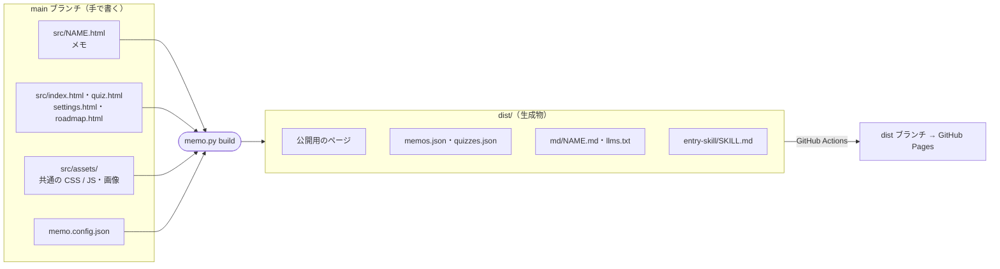
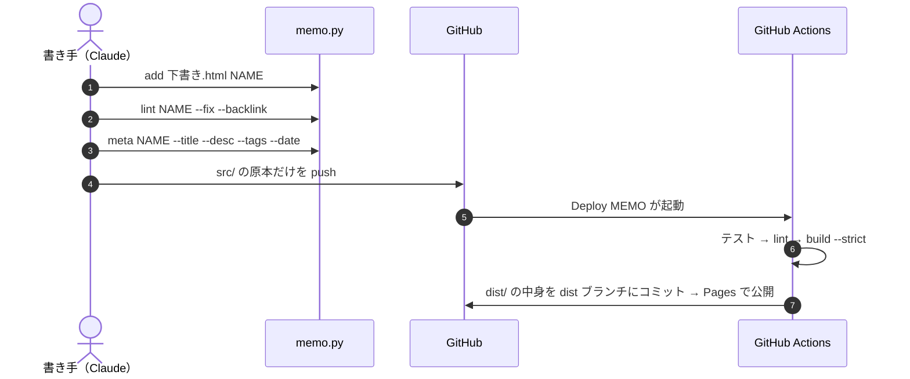
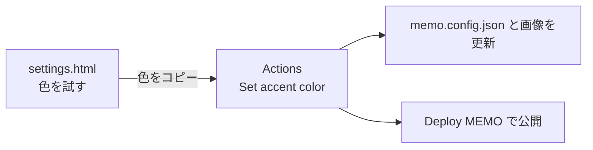
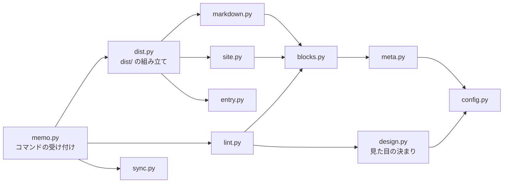

# MemoKit の仕組み

MemoKit が「何をどこに書き、どう公開するか」の説明です。セットアップの手順は [README](README.md) にあります。

- `scripts/memo.py`（処理の本体は `scripts/memolib/`）が、メモを登録・点検し、公開用のサイト一式を `dist/` に作ります。標準ライブラリだけで動きます。
- Claude が作業するときの手順はスキル（[`.claude/skills/`](.claude/skills/ROUTING.md)）にあり、Claude 向けの仕組みの説明は [`.claude/skills/mechanism/`](.claude/skills/mechanism/INDEX.md) にあります。

## 目次

- [基本の考え方](#基本の考え方)
- [全体像：原本と生成物](#全体像原本と生成物)
- [メモ 1 本の中身](#メモ-1-本の中身)
- [コマンド](#コマンド)
- [登録から公開まで](#登録から公開まで)
- [build が作るもの](#build-が作るもの)
- [サイトごとの設定（memo.config.json）](#サイトごとの設定memoconfigjson)
  - [アクセント色を変える](#アクセント色を変える)
  - [アプリ側の入口スキル](#アプリ側の入口スキル)
  - [ロードマップ（オプション）](#ロードマップオプション)
- [表示の確認とプレビュー](#表示の確認とプレビュー)
- [GitHub Actions](#github-actions)
- [コードの構成とテスト](#コードの構成とテスト)
- [変更したいときはどこを触るか](#変更したいときはどこを触るか)
- [このキットから始める](#このキットから始める)
  - [memo-kit の更新を取り込む](#memo-kit-の更新を取り込む)

## 基本の考え方

- **原本だけを手で書き、ほかはすべて生成する。** 原本は各メモの本文・`<head>` のメタ情報・クイズの問題データの 3 つです。一覧・Markdown 版・各ページに差し込むタグはスクリプトが作ります。
- **原本は `src/`、生成物は `dist/`。** `build` は `src/` を読むだけで書き換えません。`dist/` はコミットせず、GitHub Actions が中身を **dist ブランチ**に置いて GitHub Pages で公開します。公開されるのは `dist/` の中身だけです。
- **同じものを 2 か所に書かない。** クイズの CSS / JS や仕組みのページの共通処理は `src/assets/` に 1 つだけ置き、各ページは参照します。
- **サイトごとの値は `memo.config.json` だけに書く。** サイト名・リポジトリ・ブランチなどを、コード・スキル・ページに直接書きません。
- **依存してよいのは memo-kit だけ。** 同じ memo-kit から作ったほかのサイトの URL やリポジトリを参照しません（サイトが増えるたびに全サイトを直すことになるため）。

## 全体像：原本と生成物



| 場所 | 中身 |
| --- | --- |
| `src/NAME.html` | メモ 1 本（本文・メタ情報・問題データ） |
| `src/index.html` | トップページ（一覧・検索・タグ絞り込み・ランダムクイズ） |
| `src/quiz.html` | クイズページ（10 問クイズ・タイムアタック） |
| `src/settings.html` | 設定ページ（アクセント色を試す） |
| `src/roadmap.html` | ロードマップ（オプション） |
| `src/assets/` | クイズと仕組みのページの共通 CSS / JS、アイコン・OGP 画像 |
| `memo.config.json` | サイトごとの設定 |
| `dist/` | 生成物（下の「[build が作るもの](#build-が作るもの)」） |

## メモ 1 本の中身

一覧に載る情報は `<head>` から読みます。

```html
<title>Docker 動作原理</title>
<meta name="description" content="1 文の説明">
<meta name="memo:tags" content="Docker, Linux">
<meta name="memo:date" content="2026-10-31">
```

確認クイズの問題は、本文の末尾に JSON で書きます（書き方は [memo-style](.claude/skills/memo-style/SKILL.md) の「確認クイズ」）。

```html
<script type="application/json" id="memo-quiz">
[{"q": "問題文", "choices": ["A", "B", "C"], "answer": 0, "explain": "解説", "ref": "#見出しのid"}]
</script>
```

- タグは表記ゆれを防ぐため、既存のもの（`memo.py list` で見られる）を使い回します。
- 日付を書かなければ、git でそのファイルが最初に追加された日になります。
- アイコン・OGP・クイズの表示枠は、`build` が `dist/` のページにだけ差し込みます。原本には書きません。

## コマンド

```bash
python3 scripts/memo.py <コマンド> ...
```

| コマンド | やること |
| --- | --- |
| `new NAME` | テンプレートから新しいメモを作る |
| `add SRC NAME` | 外部の HTML をメモとして取り込む |
| `lint MEMO \| --all [--fix] [--backlink]` | 崩れをチェックする（`--fix` で直せるものを直す） |
| `meta MEMO [--title] [--desc] [--tags] [--date]` | タイトル・説明・タグ・日付を書く |
| `build [--check] [--strict]` | `dist/` に公開用のサイト一式を作る |
| `preview MEMO` | 共通ファイルを埋め込んだ 1 枚の HTML を作る（会話内のプレビュー用） |
| `list` / `path NAME` / `url [NAME]` / `config [KEY]` | 一覧・パス・公開 URL・設定を表示する |
| `accent COLOR [LIGHT]` | アクセント色を設定に書く |
| `sync KIT` | memo-kit の更新を取り込む |

オプションの詳細は `python3 scripts/memo.py -h`（各コマンドは `memo.py lint -h` など）で見られます。

## 登録から公開まで



GitHub の画面から HTML を直接アップロードしても、Actions の `build` が一覧に載せて公開します。

## build が作るもの

| 生成物 | 中身 |
| --- | --- |
| 各ページ | 原本に、アイコン・OGP・共通部品の CSS・アクセント色（`memo:head`）とクイズの表示枠（`memo:quiz`）、サイト名などを差し込んだもの |
| `memos.json` | 全メモのタイトル・説明・タグ・日付・問題数（トップページが読む） |
| `quizzes.json` | 全メモの問題（ランダムクイズとクイズページが読む） |
| `md/NAME.md`・`llms.txt` | AI 向けの Markdown 版と目次 |
| `entry-skill/SKILL.md` | claude.ai のアプリに登録する入口スキル |
| `assets/`・`CNAME`・`.nojekyll` | `src/` からのコピー |

**AI 向けの Markdown 版**: HTML は CSS や SVG で重いので、本文だけを Markdown にした版を作ります。公開 URL に `llms.txt` を付けたもの（例: `https://alice.github.io/notes/llms.txt`）を渡せば、リポジトリを繋いでいない会話でも Claude が過去のメモを読めます。

## サイトごとの設定（memo.config.json）

| 項目 | 内容 | 既定値 |
| --- | --- | --- |
| `site_name` | サイト名 | `MEMO` |
| `description` | トップページの説明 | 空 |
| `llms_description` | `llms.txt` の冒頭の説明 | 空 |
| `repository` | GitHub の `owner/name` | 空（`build` が警告） |
| `branch` | 原本のブランチ | `main` |
| `deploy_branch` | 公開用のブランチ（`branch` と同じにはできない） | `dist` |
| `utc_offset_hours` | 「今日」を決めるタイムゾーン | `0`（日本なら `9`） |
| `quiz` | 確認クイズを使うか | `true` |
| `roadmap` | ロードマップを公開するか | `false` |
| `branding` | アクセント色と、アイコン・OGP 画像の文字・色 | `{}` |

`branding` の主な項目は `accent`（ダークモードの色）・`accent_light`（ライトモードの色。省くと自動）・`theme`（画像のテーマ）です。ほかに画像の文字を変える `title`・`tagline`・`url`・`mark`・`icon` があり、空ならサイト名などから埋まります。

- 書き間違いがあると、`memo.py` が項目名と直し方を示して止まります。
- 公開 URL は `src/CNAME` の独自ドメイン、無ければ `https://OWNER.github.io/REPO/` です。
- アイコン・OGP 画像は `python3 branding/render.py` で作り直します（playwright などが必要。[README の「必要なもの」](README.md#必要なもの)）。

### アクセント色を変える

公開した設定ページ（`settings.html`）で色を試し、GitHub Actions の `Set accent color` で固定します。Actions が `memo.config.json` と画像を書き換え、続けてサイトを作り直して公開します（手順は [README](README.md#アクセント色を変える)）。



手元からは `python3 scripts/memo.py accent '#3ddc97'` で設定を書き換えて push しても同じです。

### アプリ側の入口スキル

claude.ai のアプリから使うときは、`build` が作る `dist/entry-skill/SKILL.md` をアプリのスキルとして登録します。中身は「このリポジトリを取ってきて、そこのスキルに従う」だけです。リポジトリ名やブランチを変えたら貼り直します。

### ロードマップ（オプション）

書いたメモとこれから書くテーマを、分野ごとに並べたチェックリストです。`memo.config.json` に `"roadmap": true` を書くと公開され、各ページにリンクが出ます。

- 項目は `src/roadmap.html` のスクリプト冒頭の `ROADMAP` に書きます。
- チェックは手で付けません。メモを公開すると自動で付きます。
- 項目を決める・その順にメモを書くのは、memo-roadmap スキル（「次のメモを書いて」など）が受け持ちます。

## 表示の確認とプレビュー

公開ページは共通ファイルを読み込むので、HTML ファイルを直接開いてもクイズや一覧は出ません。

| 開き方 | 表示 |
| --- | --- |
| 公開サイト | すべて動く |
| `build` してから `python3 -m http.server -d dist` | すべて動く |
| `memo.py preview` で作った 1 枚 | すべて動く |
| HTML ファイルを直接開く | クイズ・一覧が出ない。共通部品（ざっくり言うと・よくある誤解など）の見た目も付かない |

## GitHub Actions

| ワークフロー | いつ動くか | やること |
| --- | --- | --- |
| `Deploy MEMO`（`deploy.yml`） | デフォルトブランチへの push | テスト → lint → `build --strict` → dist ブランチにコミット |
| `Test memo.py`（`test.yml`） | スクリプト・テストなどの変更（PR も含む） | Python と JS のテスト |
| `Check parts look`（`visual.yml`） | 共通部品の CSS・テンプレートなどの変更（PR も含む） | 変更の前後のスクリーンショットを比べ、変わっていれば警告と差分画像 |
| `Set accent color`（`set-accent.yml`） | 手動 | アクセント色を固定して公開 |
| `Check memo-kit`（`kit-sync.yml`） | 週 1 回（テンプレートから作ったリポジトリだけ） | memo-kit との違いを知らせる |

最初に Settings → Actions → General → Workflow permissions を「Read and write permissions」にしておきます（[README](README.md#5-github-の設定)）。

## コードの構成とテスト



`memo.py` はコマンドを受け付けるだけで、処理は `scripts/memolib/` に役割ごとに分かれています。依存は一方向（`config` が根元）です。

```bash
python3 -B -m unittest discover -s tests   # Python のテスト（15 秒ほど）
npm ci && npm test                         # 仕組みのページの JS のテスト（Node が必要）
```

## 変更したいときはどこを触るか

| 変えたいもの | 触るもの |
| --- | --- |
| メモの本文・問題 | `src/NAME.html` |
| タイトル・説明・タグ・日付 | `memo.py meta NAME ...` |
| サイト名・リポジトリなど | `memo.config.json` |
| アクセント色 | 設定ページ → `Set accent color`、または `memo.py accent` |
| アイコン・OGP 画像 | `memo.config.json` の `branding`、デザインは `branding/` → `python3 branding/render.py` |
| トップ・クイズ・設定・ロードマップのページ | `src/index.html` など（上部のナビは 4 ページで揃える） |
| クイズの見た目・動き | `src/assets/memo-quiz.css`・`.js` |
| ざっくり言うと・よくある誤解などの共通部品の見た目 | `src/assets/memo-parts.css`（見本はテンプレート） |
| 新しいメモの雛形 | `.claude/skills/memo-style/template.html` |
| スクリプトの処理 | `scripts/memolib/`（Claude に頼むときは memo-maintain スキル） |

## このキットから始める

手順は [README の「はじめかた」](README.md#はじめかた) にあります。テンプレートから作ったリポジトリで残すもの・消すものは次のとおりです。

| | 場所 |
| --- | --- |
| **残す**（仕組み） | `scripts/`・`tests/`・`.claude/skills/`・`.github/workflows/`・`branding/`、`src/` の 4 ページと `assets/`、`memo.config.json`・`README.md`・`CLAUDE.md`・`memo-detail.md`・`LICENSE` |
| **消す**（サンプル） | `src/` 直下のサンプルのメモ（`sample*.html`）、`dist/` |

### memo-kit の更新を取り込む

テンプレートから作ったリポジトリは memo-kit と履歴を共有しないので、`sync` で取り込みます。

```bash
git clone -q --filter=blob:none https://github.com/taka1156/memo-kit.git /tmp/memo-kit
python3 scripts/memo.py sync /tmp/memo-kit --check   # 違いを見るだけ
python3 scripts/memo.py sync /tmp/memo-kit           # 取り込む
python3 -B -m unittest discover -s tests              # 通ってからコミット（.memo-kit-sync も一緒に）
```

| ファイル | sync がすること |
| --- | --- |
| 仕組み（スクリプト・テスト・ワークフロー・ドキュメントなど） | memo-kit の中身で上書きする |
| スキル（`.claude/skills/`）と `src/` の 4 ページ | 上書きせず、memo-kit で変わったものを「見比べる」として出す。差分を見て手で反映する |
| サイトのもの（設定・README・メモ・画像など） | 触らない |

最初に一度 `sync` して、できた `.memo-kit-sync` をコミットしておきます。浅い clone（`--depth 1`）だと止まるので、`--filter=blob:none` で clone します。
