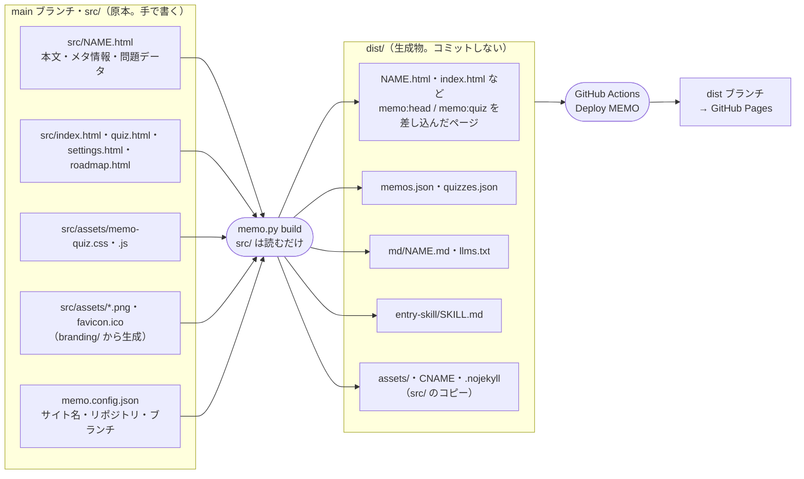
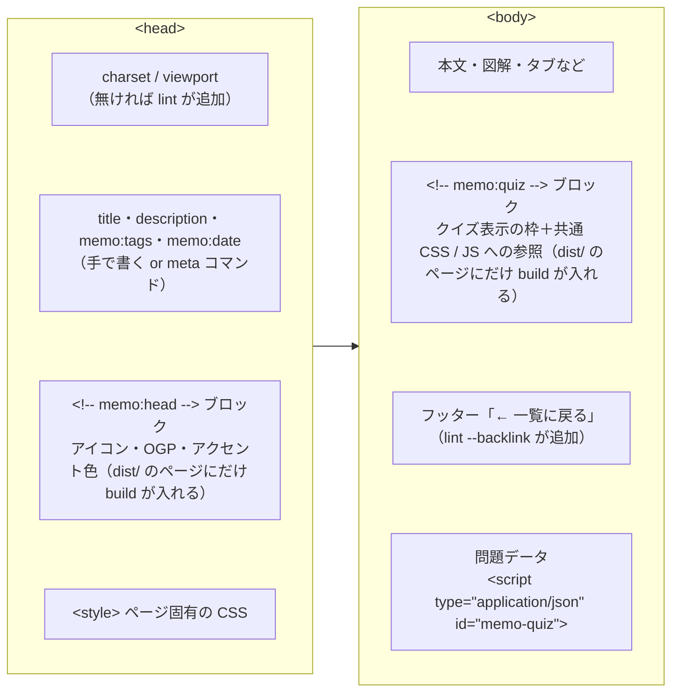
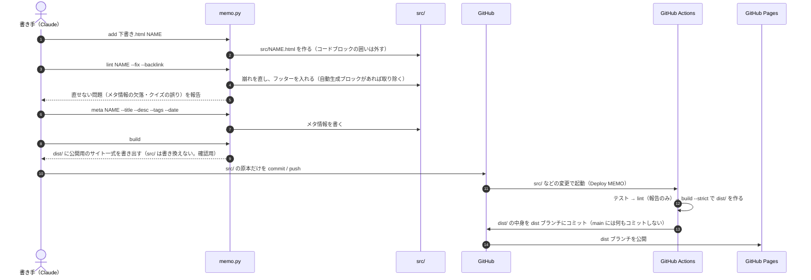
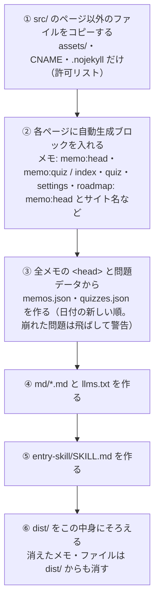
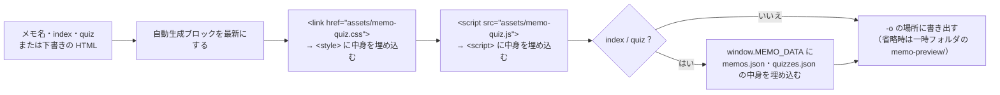
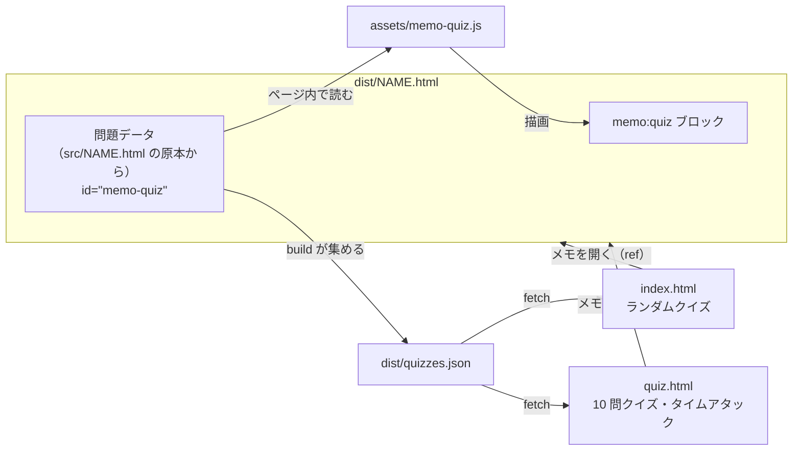
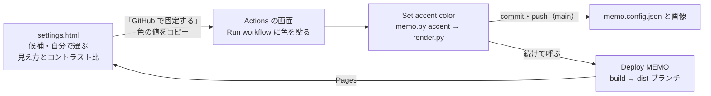
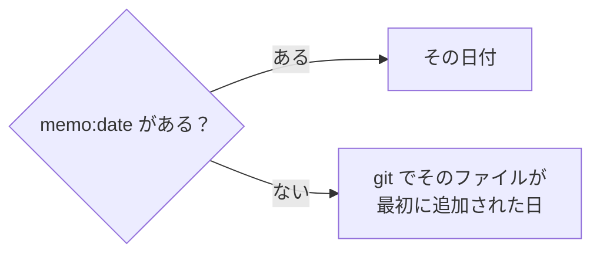
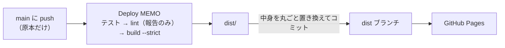
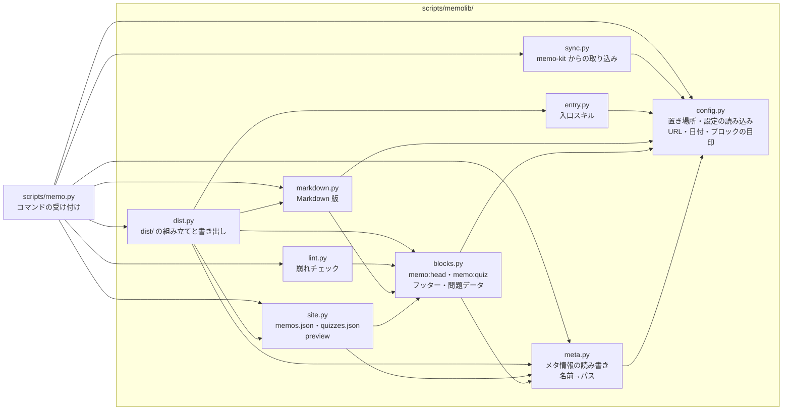

# memo.py の仕組み

`scripts/memo.py` は、MEMO リポジトリのメモ（`src/*.html`）を登録・点検し、公開用のサイト一式（一覧や AI 向けの Markdown 版を含む）を `dist/` に生成するツールです。
入口は `scripts/memo.py`、処理の本体は `scripts/memolib/` にあり、テストは `tests/` にあります。
標準ライブラリだけで動き、どのディレクトリから実行してもかまいません。

どの依頼でどのスキルを使うかは [ROUTING.md](.claude/skills/ROUTING.md)、ページのデザイン規約（クイズを使うサイトではクイズの書き方も）は [memo-style](.claude/skills/memo-style/SKILL.md)、登録の手順は [memo-publish](.claude/skills/memo-publish/SKILL.md) にあります。このファイルは「スクリプトが何をどこに書くか」の説明です。

## 目次

- [基本の考え方](#基本の考え方)
- [全体像：原本と生成物](#全体像原本と生成物)
- [メモ 1 本の中身](#メモ-1-本の中身)
- [コマンド一覧](#コマンド一覧)
- [登録の流れ](#登録の流れ)
- [各コマンドの詳細](#各コマンドの詳細)
- [自動生成ブロック](#自動生成ブロック)
- [確認クイズのデータの流れ](#確認クイズのデータの流れ)
- [AI 向けの Markdown 版](#ai-向けの-markdown-版)
- [サイトごとの設定（memo.config.json）](#サイトごとの設定memoconfigjson)
  - [トップ・クイズ・設定のページへの差し込み](#トップクイズ設定のページへの差し込み)
  - [設定ページからアクセント色を変える](#設定ページからアクセント色を変える)
  - [アプリ側の入口スキル](#アプリ側の入口スキル)
  - [ロードマップ（オプション）](#ロードマップオプション)
- [日付と URL の決まり方](#日付と-url-の決まり方)
- [表示の確認とプレビュー](#表示の確認とプレビュー)
- [GitHub Actions](#github-actions)
- [コードの構成とテスト](#コードの構成とテスト)
- [変更したいときはどこを触るか](#変更したいときはどこを触るか)
- [このキットから始める](#このキットから始める)
  - [memo-kit の更新を取り込む](#memo-kit-の更新を取り込む)

## 基本の考え方

- **原本は人（または Claude）が書く。それ以外はすべて生成する。** 原本は各メモの本文・`<head>` のメタ情報・クイズの問題データの 3 つだけで、一覧や Markdown 版、各ページに差し込むタグはスクリプトが作ります。生成されたものは手で編集しません（次の `build` で上書きされます）。
- **原本と生成物は置き場所ごと分ける。** `src/` には原本だけを置き（単体で開いて見るものではない。自動生成ブロックも一覧データもないので、表示の確認は `build` して `dist/` で行う）、`build` は `src/` を読むだけで書き換えません。生成物はすべて `dist/`（`.gitignore` 済み）に書き出し、GitHub Actions がその中身を **dist ブランチ**にコミットします。原本のブランチ（`main`）に生成物や Actions のコミットは入りません。
- **同じものを 2 か所に書かない。** クイズの表示（CSS / JS）は `src/assets/memo-quiz.*` に 1 つだけ置き、各メモは参照するだけです。
- **サイトごとの値は `memo.config.json` だけに書く。** サイト名・リポジトリ・ブランチ・タイムゾーンをコードやスキル、ページに直接書きません（[サイトごとの設定](#サイトごとの設定memoconfigjson)）。
- **置き場所を知っているのはスクリプトだけ。** メモは名前（`docker` など）で指定し、パスは `memo.py path NAME` で引きます。スキル側でパスを組み立てません。
- **公開されるのは `dist/` の中身だけ。** GitHub Pages の公開元は dist ブランチ（`dist/` の中身そのもの）なので、スクリプト・スキル・このファイルは公開されません。
- **依存してよいのは memo-kit だけ。** テンプレートから作ったサイトは、memo-kit（テンプレート元）以外のものに依存しません。同じ memo-kit から作ったほかのサイトの URL・`llms.txt`・リポジトリを、スキル・スクリプト・ワークフロー・ページから参照しません（サイトが増えるたびに全サイトを直すことになるため）。書く範囲の重なりや食い違いは、そのサイトの中だけで確かめます。

## 全体像：原本と生成物



| ファイル | 種類 | 作る人 | 中身 |
| --- | --- | --- | --- |
| `src/NAME.html` | メモ（原本） | 人 | 本文とメタ情報と問題データ。自動生成ブロックは入れない（`build` が `dist/` のページにだけ入れる） |
| `src/index.html` | トップページ（原本） | 人 | 一覧・検索・タグ絞り込み・ランダムクイズ。データは JSON から読む。サイト名・説明・リポジトリへのリンクは `build` が `memo.config.json` から入れる |
| `src/quiz.html` | クイズページ（原本） | 人 | ランダム 10 問・カテゴリ別 10 問と、タイムアタック（制限時間内に何問正解できるか。ランダムかカテゴリ別）。カテゴリは複数選べ、どれかに入る問題から出す。データは JSON から読む。サイト名は `build` が入れる |
| `src/settings.html` | 設定ページ（原本） | 人 | アクセント色を試し、Actions で固定する手順へ進む（各ページ上部のナビ、またはトップページのフッターの「設定」から開く。[設定ページからアクセント色を変える](#設定ページからアクセント色を変える)）。今の色・サイト名・Actions へのリンクは `build` が入れる |
| `src/roadmap.html` | ロードマップ（原本・オプション） | 人 | 書いたメモと、これから書くテーマを分野ごとに並べたチェックリスト。`memo.config.json` の `roadmap` が `true` のときだけ公開し、各ページ上部のナビ、またはトップページのフッターの「ロードマップ」から開く（[ロードマップ（オプション）](#ロードマップオプション)）。項目はページのスクリプト冒頭の `ROADMAP` に書き、`memos.json` に項目のファイル名（`file` か別名の `alt`）があれば自動でチェックが付く。どの項目にも当てはまらないメモは「ロードマップ外のメモ」に並ぶ。サイト名は `build` が入れる |
| `memo.config.json` | 設定 | 人（アクセント色は `memo.py accent` でも） | サイト名・説明・リポジトリ・ブランチ・デプロイ先のブランチ・タイムゾーン・アクセント色とアイコン/OGP 画像の文字 |
| `dist/NAME.html` など | 生成物 | `build` | 原本に `memo:head`・`memo:quiz` ブロックとサイト設定を差し込んだ公開用のページ |
| `dist/entry-skill/SKILL.md` | 生成物 | `build` | claude.ai のアプリ側に置く入口スキル（リポジトリ名とブランチ入り） |
| `dist/memos.json` | 生成物 | `build` | 全メモのタイトル・説明・タグ・日付・問題数 |
| `dist/quizzes.json` | 生成物 | `build` | 全メモの問題（どのメモの問題かも含む）。1 問 1 行 |
| `dist/md/NAME.md` | 生成物 | `build` | 各メモの本文を Markdown にしたもの |
| `dist/llms.txt` | 生成物 | `build` | 全メモの目次（Markdown 版へのリンク） |
| `dist/assets/`・`CNAME`・`.nojekyll` | 生成物（コピー） | `build` | `src/` のページ以外のファイルをそのままコピーしたもの。コピーするのは `src/` 直下の `CNAME`・`.nojekyll` と `assets/` の下（ドットファイルと `.bak` などのバックアップは除く）だけで、それ以外（下書きのフォルダ・`.env`・シンボリックリンクなど）は公開せずに警告する |
| `src/assets/memo-quiz.css`・`.js` | 共通ファイル | 人 | 確認クイズの見た目と動き |
| `src/assets/*.png`・`favicon.ico` | 共通ファイル | `branding/render.py` | アイコンと OGP 画像 |
| `.claude/skills/memo-style/template.html` | テンプレート | 人 | `new` で新しいメモを作るときの雛形 |

## メモ 1 本の中身



一覧に載る情報は `<head>` から読みます。

```html
<title>Docker 動作原理</title>
<meta name="description" content="1 文の説明">
<meta name="memo:tags" content="Docker, Linux">
<meta name="memo:date" content="2026-10-31">
```

- タイトルは `<meta name="memo:title">` があればそちらを優先し、無ければ `<title>`、それも無ければファイル名。
- タグはカンマ区切り。表記ゆれを防ぐため、既存のタグ（`memo.py list` で見られる）を使い回します。
- 日付の決まり方は[日付と URL の決まり方](#日付と-url-の決まり方)を参照。

問題データの書式と作問ルールは [memo-style](.claude/skills/memo-style/SKILL.md) の「確認クイズ」にあります（クイズを使うサイトのみ。`quiz` が `false` のサイトでは memo-style からその節を省いてかまいません）。

```html
<script type="application/json" id="memo-quiz">
[{"q": "問題文", "choices": ["A", "B", "C"], "answer": 0, "explain": "解説", "ref": "#見出しのid"}]
</script>
```

## コマンド一覧

```bash
python3 scripts/memo.py <コマンド> ...
```

| コマンド | 使い方 | やること | ファイルを書き換えるか |
| --- | --- | --- | --- |
| `new` | `new NAME` | テンプレートから `src/NAME.html` を作る | 作る |
| `add` | `add SRC NAME [--force]` | 外部の HTML を `src/NAME.html` として取り込む | 作る（`--force` で上書き） |
| `path` | `path NAME [--md]` | メモ（または Markdown 版）の絶対パスを表示 | しない |
| `url` | `url [NAME]` | 公開 URL を表示 | しない |
| `lint` | `lint MEMO... [--fix] [--backlink]` | 崩れのチェック。`--fix` で直せるものを直す | `--fix` のときだけ |
| `meta` | `meta MEMO [--title] [--desc] [--tags] [--date]` | メタ情報を設定する | する（指定した項目だけ） |
| `build` | `build [--check] [--strict]` | `src/` から公開用のサイト一式を `dist/` に書き出す。`--check` は `dist/` が古いかどうかだけ調べる。`--strict` はクイズの崩れや公開しないファイルの警告があれば書き出さずに止める（デプロイが使う） | `dist/` だけ（`--check` 以外）。`src/` は書き換えない |
| `list` | `list` | メモの一覧（日付・名前・タイトル・タグ）を表示 | しない |
| `sync` | `sync KIT [--check] [--force]` | memo-kit を clone したフォルダ `KIT` から仕組みのファイルを取り込む。`--check` は違いを表示するだけ（上書きするファイルに違いがあれば終了コード 1）。`--force` は「memo-kit らしくない」「前回より古い」でも続ける。詳しくは [memo-kit の更新を取り込む](#memo-kit-の更新を取り込む) | 仕組みのファイルと `.memo-kit-sync`（`--check` 以外） |
| `config` | `config [KEY]` | `memo.config.json` の設定（と公開 URL `site_url`）を表示 | しない |
| `accent` | `accent COLOR [LIGHT]` | アクセント色を `memo.config.json` に書く（`LIGHT` を省くと `COLOR` から自動）。ページへの反映は `build`（公開はデプロイ） | `memo.config.json` だけ |
| `preview` | `preview MEMO\|index\|quiz\|settings\|roadmap\|FILE [-o OUT]` | 共通ファイルを埋め込んだ 1 枚の HTML を書き出す | 元のファイルはしない |

`MEMO` / `NAME` は `docker`・`docker.html`・`src/docker.html` のどれでもよく、既存のファイルパスを渡せばそのファイルが対象になります（下書きの点検に使えます）。
名前は英小文字・数字・ハイフンだけで、`index`・`quiz`・`settings`・`roadmap` は特別なページなのでメモ名に使えません。

## 登録の流れ

[memo-publish](.claude/skills/memo-publish/SKILL.md) の手順を、スクリプトの動きで見るとこうなります。



GitHub の画面から HTML を直接アップロードした場合も、Actions の `build` が自動生成ブロックと一覧を入れて公開するので、一覧に載ります。

## 各コマンドの詳細

### new / add

- `new` は `.claude/skills/memo-style/template.html` をコピーするだけです。同名のファイルがあれば止まります。
- `add` は外部の HTML を取り込みます。Markdown のコードブロック（```` ```html ... ``` ````）に包まれていれば中身だけを取り出します。同名のファイルがあれば止まり、`--force` で上書きします。
- メモと取り込む HTML は UTF-8 で読みます。UTF-8 で読めないファイル（Shift_JIS など）があると、どのコマンドでもそのファイル名を示して止まります。

### lint

`lint` は「自動で直せるもの」と「人が直すもの（`[要対応]`）」を分けて報告します。`--fix` を付けたときだけ書き込みます。

| 分類 | 内容 |
| --- | --- |
| 直す | `<style>` 内の全角クォート `‘’“”`（コピペで化けて font-family などが効かなくなる） |
| 直す | `* {` が `- {` や `\*` に化けたもの（Markdown 経由のコピペで起きる） |
| 直す | `<!DOCTYPE html>`・charset・viewport の欠落 |
| 直す | フッターの「← 一覧に戻る」リンク（`--backlink` のとき。無ければ追加） |
| 直す | 原本に入っている `memo:head`・`memo:quiz` ブロックの削除（古い形のページや、公開ページからコピーした HTML。ブロックは `build` が `dist/` にだけ入れる） |
| 報告 | JS 内で全角クォートが文字列の区切りに使われている疑い |
| 報告 | タイトル・説明・タグ・日付の欠落 |
| 報告 | 一覧へのリンクが無い（`--backlink` を付けていないとき） |
| 報告 | クイズの JSON の崩れ・形の誤り・`ref` の飛び先が無い・正解の位置が全問同じ |

終了コードは、報告が残るか、`--fix` なしで直せるものがあれば 1、それ以外は 0 です。

### meta

指定した項目だけを書き換えます。OGP のタイトル・説明は、次の `build` で `dist/` のページに反映されます。

- `--tags` はカンマ区切りで渡し、前後の空白を整えて保存します。
- `--date` は値を付ければその日付（`YYYY-MM-DD`。形式やありえない日付はエラー）、値なしなら**設定のタイムゾーン（`utc_offset_hours`）の今日**です（[日付と URL の決まり方](#日付と-url-の決まり方)）。

### build

`build` は `src/` を読むだけで書き換えず、`dist/` に置くべきファイルをすべて組み立ててから、`dist/` をその中身にそろえます（変わったファイルだけ書き、要らなくなったファイルは消す）。



- `memo.config.json` の `repository` が空・`owner/name` の形でない・テンプレートの値（`repo/sample`）のままのときは、最初に警告を出します（止めずに続けます）。入口スキルの clone 先や公開 URL がおかしくなるのを防ぐためです。
- `--check` は何も書き込まず、`dist/` に古い（足りない・余分な）ファイルがあれば名前を表示して終了コード 1 を返します。
- `--strict` は、クイズの崩れ（JSON の壊れや形の誤りで、問題が公開から落ちるもの）や公開しないファイル（`src/` の許可リスト外）の警告が 1 件でもあれば、`dist/` を書き出さずに終了コード 1 を返します。`--strict` なしなら、警告を出して続けます（崩れた問題は飛ばし、許可リスト外のファイルは公開しない）。`repository` がテンプレートのままという警告では止まりません。
- `dist/` を消して `build` し直しても同じ中身になります。`dist/` は `.gitignore` 済みで、コミットするのは `src/` の原本だけです。
- `memos.json` の各メモには、そのメモの問題数（`quizzes`）も入ります。トップページはこれを足してランダムクイズの問題数を表示し、問題本体（`quizzes.json`）はランダムクイズを開いたときに初めて読み込みます。

### list / path / url

- `list` は `日付  ファイル名  タイトル  [タグ]` の形で全メモを表示します。
- `path NAME` は `src/NAME.html` の絶対パス、`--md` を付けると `dist/md/NAME.md` のパスを表示します（`build` してから読む）。
- `url NAME` は公開 URL を表示します（名前なしならトップ）。

### preview

公開するページは共通ファイル（クイズの CSS / JS、一覧の JSON）を読み込むので、HTML 1 枚だけを渡す場面（会話内のプレビューなど）では動きません。`preview` はそれらを埋め込んだコピーを書き出します。元のファイルは変更しません。



埋め込む中身は公開版と同じファイルから取るので、見た目と動きは公開版と変わりません。トップページとクイズページは、`window.MEMO_DATA` があればそれを使い、無ければ JSON を fetch します。

## 自動生成ブロック

`build`（と `preview`）が `dist/` のページに差し込むブロックです。原本（`src/`）には入りません。開始と終了のコメントで囲まれていて、毎回まるごと作り直されます。

| ブロック | 入る場所 | 中身 | 作るもの |
| --- | --- | --- | --- |
| `<!-- memo:head -->` 〜 `<!-- /memo:head -->` | `</head>` の直前 | ファビコン・iOS アイコン・OGP（`og:title` / `og:description` は title / description から）、アクセント色（`branding.accent`・`accent_light`） | `build`・`preview` |
| `<!-- memo:quiz -->` 〜 `<!-- /memo:quiz -->` | フッターの直前（無ければ `</body>` の直前） | クイズ表示の枠と、`assets/memo-quiz.css`・`.js` への参照。問題データが無いメモには入らない | `build`・`preview` |
| `data-memo-site` の付いた要素・属性 | `index.html`・`quiz.html`・`settings.html`・`roadmap.html` の書いた場所 | `memo.config.json` の値（[サイトごとの設定](#サイトごとの設定memoconfigjson)）。目印の属性は残る | `build`・`preview` |
| `data-memo-if` の付いた要素 | `index.html` の書いた場所 | 設定の項目（`quiz`・`roadmap`）がオフなら要素ごと取り除く。オンならそのまま | `build`・`preview` |
| `<footer id="memo-backlink">` | `</body>` の直前 | 「← 一覧に戻る」リンク。スタイルはインラインで完結。これだけは原本に入る | `lint --backlink`（無いときだけ追加） |

## 確認クイズのデータの流れ

問題の原本は各メモの中にだけあり、ほかはすべてそこから作られます。



- `ref`（`"#見出しのid"`）があると、間違えたときに本文の該当箇所へのリンクが出ます。飛び先が閉じたタブや `<details>` の中にあれば、`memo-quiz.js` が開いてから移動します。
- `quiz.html` のタイムアタックは、条件（ランダムかカテゴリ）に合う全問をシャッフルして、制限時間（30 秒／1 分／3 分）が切れるか問題が尽きるまで出します。答えるとすぐ次の問題に進み（正誤・解説は出さない）、結果で全問の正解と解説をまとめて見せます。残り時間はバーと秒数で表示し、条件ごとの自己ベストはブラウザ（localStorage）に保存します。カテゴリは 10 問モードと同じく複数選べます。URL は `quiz.html?mode=timeattack&time=60&tag=…&tag=…`（カテゴリごとに `tag` を並べる。10 問モードは `quiz.html?tag=…&tag=…`）で、直接開いてもはじめられます。
- `memo.config.json` の `quiz` を `false` にすると、上の図のうち `memo:quiz` ブロック・`quizzes.json`・`quiz.html`・トップのランダムクイズをどれも作りません（[サイトごとの設定](#サイトごとの設定memoconfigjson)）。
- 問題を直すときは各メモの問題データだけを直し、`build` で `quizzes.json` に反映します。

## AI 向けの Markdown 版

`build` は Claude などが HTML（CSS・SVG 込みで重い）を読まずに中身を把握できるよう、本文を Markdown にした版を作ります。

| 出力 | 中身 |
| --- | --- |
| `dist/llms.txt` | 全メモの目次。タイトル・説明・タグ・日付と、各 Markdown 版へのリンク |
| `dist/md/NAME.md` | 冒頭にタイトル・説明・URL・タグ・日付、続けて本文 |

変換のルール:

- `<head>`・CSS・JS・クイズの表示ブロック・フッターは除きます。問題データは本文に含めません。
- SVG の図は、中の文字（ラベル）だけを残します。
- 図や操作できるパーツがある節には、元のページのその節へのリンクを付けます。
- 本文の大半を JavaScript のデータから描画するページは、HTML からは中身が取れないので、そのスクリプトをコードブロックとして末尾に付けます。
- 別のメモへのリンクは、そのメモの Markdown 版へのリンクに置き換えます。

公開 URL は `python3 scripts/memo.py url` の後ろに `llms.txt` を付けたもの（例: `https://alice.github.io/notes/llms.txt`）です。リポジトリを繋いでいない会話でも、この URL を渡せば Claude が過去のメモを参照できます。

## サイトごとの設定（memo.config.json）

サイトごとに変わる値は、リポジトリ直下の `memo.config.json` に 1 か所だけ書きます。コード・スキル・ページはここから読むので、別のリポジトリで使うときもこのファイルと `src/CNAME` を変えれば済みます。

| 項目 | 使われる場所 | 既定値 |
| --- | --- | --- |
| `site_name` | 各ページの OGP・iOS アイコン名、トップとクイズのページの `<title>`・見出し、`llms.txt` の見出し、入口スキルの説明、アイコン・OGP 画像の文字 | `MEMO` |
| `description` | トップページの説明（本文と `<meta name="description">`、OGP）、OGP 画像の説明文 | 空 |
| `llms_description` | `llms.txt` の冒頭の説明（空なら書かない） | 空 |
| `repository` | トップページのリンク、`src/CNAME` が無いときの公開 URL、入口スキル（clone 先・スキル名） | 空（`build` が警告） |
| `branch` | 原本のブランチ。スキルの push 先（`python3 scripts/memo.py config branch` で読む）、入口スキルの raw URL | `main` |
| `deploy_branch` | `build` の出力（`dist/`）をデプロイするブランチ。GitHub Pages の公開元にする（Deploy MEMO が `config deploy_branch` で読む）。`branch` と同じにはできない | `dist` |
| `utc_offset_hours` | `meta --date` の「今日」 | `0`（日本なら `9`） |
| `branding` | 全ページのアクセント色（`memo:head` に入る）と、アイコン・OGP 画像（`branding/render.py`）。下の表 | `{}` |
| `quiz` | 確認クイズを使うか。`false` なら `build` が `quiz.html`・`quizzes.json`・クイズの共通 CSS / JS（`assets/memo-quiz.*`）を `dist/` に出さず、各メモにクイズの表示（`memo:quiz` ブロック）を入れず、トップページのランダムクイズ（`data-memo-if="quiz"`）を取り除く。`memos.json` の問題数は 0 になる。原本の問題データは残るので、`true` に戻して `build` すれば元どおり出る。スキルも新しいメモにクイズを書かなくなる | `true` |
| `roadmap` | ロードマップ（`src/roadmap.html`）を公開して、トップページからリンクするか。`true` か `false`（[ロードマップ（オプション）](#ロードマップオプション)） | `false` |

`branding` の中の項目（空欄はほかの設定から埋まります）:

| 項目 | 使われる場所 | 空のとき |
| --- | --- | --- |
| `title` | OGP 画像の大きな文字（長ければ縮めて、それでも入らなければ … で切る） | `site_name` |
| `tagline` | OGP 画像の説明文（2 行まで） | `description` |
| `url` | OGP 画像に小さく出す URL | 公開 URL のホスト名とパス |
| `mark` | アイコンの文字（1〜2 文字がおすすめ） | `title` の先頭 1 文字 |
| `icon` | アイコンの絵柄。`mark`（紙に `mark` の文字）か `lines`（文字なし。小さいアイコンは横線 3 本） | `mark` |
| `accent` | ダークモードのページの `--accent`（見出し・強調・リンク）と、`theme: dark` の画像の色（題字・余白線・ペン）。`#rgb` か `#rrggbb` | 空にはできない（既定 `#00d4ff`） |
| `accent_light` | ライトモードのページの `--accent` と、`theme: light` の画像の色 | `accent` を白地とのコントラスト比 4.5 以上になるまで暗くした色 |
| `theme` | 画像のテーマ。`dark` か `light`（ページはライト・ダークの両方に自動で対応） | `dark` |

- 書き間違い（JSON の書式、文字列であるべき項目に数値、`site_name`・`branch`・`deploy_branch` が空、`deploy_branch` が `branch` と同じ、`utc_offset_hours` が -24〜24 の外、`quiz`・`roadmap` が true/false 以外など）は、項目名と直し方を示して止まります（traceback は出しません）。
- 書かなかった項目は既定値（`scripts/memolib/config.py` の `DEFAULTS`・`BRANDING_DEFAULTS`）になります。知らない項目や、`accent`・`accent_light`・`icon`・`theme` のおかしな値があるとエラーで止まります（綴りの間違いに気づけるように）。
- アクセント色は `build` が `dist/` の全ページの `memo:head` に `<style id="memo-accent">` として入れます。各ページの `:root` の `--accent` より強い `html:root` で書くので、ページ側の値（テンプレートの既定値）は上書きされます。
- `branding` を変えても `build` だけでは画像は変わりません。`python3 branding/render.py` で作り直します（設定ページから `Set accent color` で固定したときは、Actions が作り直します）（[日付と URL の決まり方](#日付と-url-の決まり方) の「URL」）。
- `python3 scripts/memo.py config` で今の設定（と公開 URL）を表示できます。

### トップ・クイズ・設定のページへの差し込み

`src/index.html`・`src/quiz.html`・`src/settings.html`・`src/roadmap.html` のサイト名などは手で書かず、目印の属性を付けておくと `build` が設定の値で書き換えて `dist/` に書き出します（原本の値はそのまま。表示されるのは `dist/` 側の値）。書式の中では `{site_name}`・`{description}`・`{repository}`・`{branch}`・`{accent}`（ダーク用のアクセント色）・`{accent_light}`（ライト用。自動のときは計算した色）が使えます。

```html
<h1 data-memo-site="{site_name}">MEMO</h1>                       <!-- 中身のテキストを置き換える -->
<a href="…" data-memo-site-href="https://github.com/{repository}">  <!-- href 属性を置き換える -->
<meta name="description" content="…" data-memo-site-content="{description}">  <!-- content 属性を置き換える -->
```

目印の属性は残るので、何度 `build` しても同じ結果になります。中身がテキストだけの要素に使います（子要素があると中身ごと置き換わります）。

### 設定ページからアクセント色を変える

GitHub Pages は表示するだけなので、ページから設定ファイルを書き換えることはできません。そこで、色を試すのは公開ページ（`settings.html`）、固定するのは GitHub Actions（`.github/workflows/set-accent.yml`、名前は `Set accent color`）に分けています。



- 設定ページで色を選ぶと、そのページの色だけがその場で変わります（ほかのページは固定するまで変わりません）。ライト用は「自動」にすると、`build` と同じ計算（白地とのコントラスト比 4.5 以上になるまで暗くする）で決まります。
- 「GitHub で固定する」は、そのリポジトリの `Set accent color` の画面を開くだけです。色の値は自動では入らないので、ページに出た `accent`・`accent_light` をコピーして「Run workflow」の入力欄に貼ります（ライト用を自動にしたときは空のまま）。
- 実行できるのは、リポジトリに書き込み権限がある人だけです。ページは公開されていますが、見た人が色を変えることはできません。
- ワークフローは `python3 scripts/memo.py accent COLOR [LIGHT]` で `memo.config.json` の `branding.accent`・`accent_light` だけを書き換え（ほかの項目と並び順はそのまま）、必要なら画像を作り直して `Set accent color: …` としてコミット・push し、続けて `Deploy MEMO` を呼んで全ページを作り直して公開します（Actions からの push では push で動くワークフローが起動しないため、直接呼ぶ）。色の書き方が正しくなければ、何もコミットせずに止まります。
- 「アイコン・OGP 画像も同じ色で作り直す」（`images`。既定でオン）のときは、Actions に playwright・chromium・Pillow・フォントを入れて `branding/render.py` も動かします。そのぶん 3〜5 分かかります。画像はそのままでよければチェックを外します（1〜2 分）。
- 手元や Claude からは、`python3 scripts/memo.py accent '#3ddc97' '#0f7a50'` → `memo.config.json` をコミット・push すれば、Deploy MEMO が同じように公開します（手元の `build` は確認用）。

### アプリ側の入口スキル

claude.ai のアプリに置く入口スキルは「このリポジトリを取ってきて、ここのスキルに従う」だけのものです。リポジトリ名とブランチだけはアプリ側で知っている必要があるので、`build` が設定から `dist/entry-skill/SKILL.md` を作ります（dist ブランチと公開サイトの `/entry-skill/SKILL.md` にも置かれます）。設定を変えたら、これをアプリ側のスキルに貼り直します。

スキル名はリポジトリ名から作ります。スキル名に使えるのは小文字・数字・ハイフンだけなので、大文字は小文字に、それ以外の文字（`.` `_` など）はハイフンにします（`Alice/My.Notes` → `my-notes`、`alice/alice.github.io` → `alice-github-io`。64 文字まで）。clone 先のフォルダ名はリポジトリ名のままです。

### ロードマップ（オプション）

`src/roadmap.html` は、書いたメモとこれから書くテーマを分野ごとに並べたチェックリストです。必ず要るものではないので、既定ではオフです。`memo.config.json` に `"roadmap": true` を書いて `build` すると公開され、各ページ上部のナビとトップページのフッターに「ロードマップ」のリンクが出ます。

- 項目はページのスクリプト冒頭の `ROADMAP` に書きます。書いたメモは `file` だけ、これから書くテーマは `title`・`prio`（`high` / `mid` / `low`）・`note` も書きます。別の名前でも済みにしたいときは `alt` にファイル名を並べます。
- 項目を相談して決める・その順にメモを書く・書いたメモを項目に足す、は memo-roadmap スキル（`.claude/skills/memo-roadmap/`）の手順で行います（「次のメモを書いて」など）。このスキルが無いリポジトリでロードマップを使うときは、memo-kit から持ってきて `.claude/skills/ROUTING.md` の表にも足します。
- チェックは手で付けません。ページが `memos.json` を読み、項目の `file` か `alt` があれば済みにします。どの項目にも当てはまらないメモは「ロードマップ外のメモ」に並びます。
- オフのときは、`build` が `dist/` に `roadmap.html` を出さず、ほかのページの `data-memo-if="roadmap"` の付いた要素（トップページのリンク）を取り除きます。オンなら何もしません。

```html
<span data-memo-if="roadmap">· <a href="roadmap.html">ロードマップ</a></span>  <!-- roadmap が false なら要素ごと消える -->
```

使える項目は `scripts/memolib/config.py` の `OPTIONAL_PAGES`（ページ名と設定の項目の対応）の値だけです。中に同じ名前のタグを入れ子にしないでください（最初の閉じタグまでを 1 つの要素とみなします）。

## 日付と URL の決まり方

**日付（`memo:date`）**



- `meta --date` を値なしで実行すると、**`memo.config.json` の `utc_offset_hours` のタイムゾーンでの今日**が入ります（日本なら 9）。実行環境の時計が UTC でも、たとえば日本時間の朝 9 時前に前日の日付になることはありません。
- `meta --date 2026-11-04` のように値を付ければその日付になります。
- 登録後は `memo.py list` で日付を確認します。

**URL**

- 公開 URL は `src/CNAME` の独自ドメインから決まります（無ければ `memo.config.json` の `repository` から GitHub Pages の URL `https://OWNER.github.io/REPO/` を作ります）。`og:url`・`og:image` の絶対 URL にも使います。
- `og:image` には `og.png` の中身から作った短いハッシュ（`?v=…`）を付けます。画像を差し替えると URL が変わり、SNS 側の画像キャッシュが古いまま残るのを防げます。
- アイコンと OGP 画像の生成元は `branding/`（`og.html`・`icon.html`・`leaf.css`）で、`python3 branding/render.py` で `src/assets/` に書き出します（`branding/` は公開されません）。文字と色は `memo.config.json`（`site_name`・`description`・公開 URL と `branding`）から差し込むので、HTML を直接書き換える必要はありません。
- `render.py` だけは標準ライブラリでは動きません（`pip install playwright pillow` と `python3 -m playwright install chromium`、フォント Noto Sans CJK JP / DejaVu Sans Mono が必要。Ubuntu なら `apt install fonts-noto-cjk fonts-dejavu-core`）。Actions では `Set accent color` だけが動かします。それ以外の設定（サイト名・`branding` の文字など）を変えたら手元で実行し、できた画像をコミットします。`og.png` が変わると、次の `build`（デプロイ）で `og:image` の `?v=` が更新されます。

## 表示の確認とプレビュー

公開ページは共通ファイルを読み込むので、開き方によって表示が変わります。

| 開き方 | 各メモのクイズ | トップの一覧・ランダムクイズ | クイズページ |
| --- | --- | --- | --- |
| 公開サイト（GitHub Pages） | 動く | 動く | 動く |
| `build` してからローカルサーバー `python3 -m http.server -d dist` | 動く | 動く | 動く |
| `memo.py preview` で作った 1 枚 | 動く | 動く | 動く |
| HTML ファイルを直接開く・そのまま会話に送る | 出ない | 「読み込めませんでした」と表示 | 「読み込めませんでした」と表示 |

会話内で下書きを見せるときの手順は [memo-style の「会話内でプレビューするとき」](.claude/skills/memo-style/SKILL.md) にあります。

```bash
python3 scripts/memo.py lint 下書き.html --fix --backlink
python3 scripts/memo.py preview 下書き.html -o /tmp/NAME.html
```

## GitHub Actions

`.github/workflows/deploy.yml`（`Deploy MEMO`）が、デフォルトブランチへの push で `build` して、`dist/` の中身を dist ブランチにコミットします（ブランチ名はワークフローに書いていないので、`main` でも `master` でも動きます。デプロイ先は `memo.config.json` の `deploy_branch`）。GitHub Pages の公開元は dist ブランチ（`/`（root））にします。



| 項目 | 内容 |
| --- | --- |
| 起動する変更 | `src/` 以下・`scripts/` 以下・`memo.config.json`・このワークフロー（手動実行も可。`Set accent color` からも呼ばれる） |
| 手順 | 履歴ごと checkout（日付の推定に使う）→ テスト（仕組みだけ。`MEMO_SKIP_REPO_TESTS` で本物のメモの検査は飛ばす。落ちたら公開しない）→ 全メモを `lint`（報告のみ。指摘があれば注釈を出す。メモが 0 本なら省略）→ `build --strict`（クイズの崩れや公開しないファイルがあれば止める） |
| コミット | dist ブランチを `dist/` の中身で丸ごと置き換え、変わっていれば `Deploy <元のコミット>` としてコミット・push。dist ブランチの履歴は残るので、生成物の変化も追える。ブランチがまだなければ履歴のない（orphan）ブランチとして作る |
| 原本のブランチ | 何もコミットしない（以前の `Rebuild MEMO index` のような Actions のコミットは入らない） |
| 同時実行 | 同じブランチの実行は 1 本ずつ順番に動く（`concurrency`。途中で止めない）。dist ブランチに書くのはこのワークフローだけなので、push の競合は起きない |

`.github/workflows/kit-sync.yml`（`Check memo-kit`）は、テンプレートから作ったリポジトリで週に 1 回、仕組みのファイルが memo-kit と違っていないかを確かめて知らせます（[memo-kit の更新を取り込む](#memo-kit-の更新を取り込む)）。

もう 1 つの `.github/workflows/test.yml`（`Test memo.py`）は、`scripts/`・`tests/`・クイズの共通ファイル・トップ・クイズ・設定・ロードマップのページ・`memo.config.json`・テンプレートが変わったとき（どのブランチでも、PR も含む）にテストを流します。リポジトリは書き換えません。

## コードの構成とテスト

入口の `scripts/memo.py` はコマンドを受け付けるだけで、処理の本体は `scripts/memolib/` に役割ごとに分かれています。
コードを直すときの手順（テストの流し方、出力が変わっていないことの確かめ方、更新するドキュメント）は [memo-maintain](.claude/skills/memo-maintain/SKILL.md) にあります。



矢印は「使っている」向きです。依存は一方向（`config` ← `meta` ← `blocks` ← `lint`・`markdown`・`site` ← `dist` ← `memo.py`、`config` ← `entry` ← `dist`）で、逆向きの import はありません。

| ファイル | 役割 | 主な関数 |
| --- | --- | --- |
| `scripts/memo.py` | コマンドの受け付け | `cmd_build`・`cmd_lint`・`cmd_preview` など、`main` |
| `memolib/config.py` | 置き場所（原本の `src/`・出力の `dist/`）・`memo.config.json` の読み込み・公開 URL・日付・自動生成ブロックの目印 | `load_config`・`today`・`site_url`・`pages_url`・`asset_version` |
| `memolib/meta.py` | `<head>` のメタ情報の読み書き、名前からパスへの解決 | `read_meta`・`set_meta`・`memo_path`・`memo_files` |
| `memolib/blocks.py` | 自動生成ブロック、サイト設定の差し込み、「一覧に戻る」フッター、クイズの問題データ | `head_block`・`apply_site`・`apply_quiz`・`apply_generated`・`strip_generated`・`read_quiz`・`validate_quiz` |
| `memolib/entry.py` | アプリ側の入口スキルの中身 | `entry_skill` |
| `memolib/lint.py` | 崩れのチェックと自動修正 | `lint_text` |
| `memolib/markdown.py` | AI 向けの Markdown 版 | `html_to_markdown`・`memo_markdown`・`llms_txt`・`markdown_outputs` |
| `memolib/site.py` | 一覧・問題の JSON、会話内プレビュー用の 1 枚の HTML | `site_data`・`memos_json`・`quizzes_json`・`preview_text` |
| `memolib/dist.py` | `dist/` に置く全ファイルの組み立て（`src/` のコピー＋生成物）と書き出し | `dist_outputs`・`sync_dist` |
| `memolib/sync.py` | memo-kit から仕組みのファイルを取り込む（上書きする・見比べる・触らないの一覧と、前回取り込んだコミットの記録） | `kit_problems`・`own_problems`・`plan`・`apply` |

多くの関数は「HTML の文字列を受け取って文字列を返す」だけで、ファイルを書き換えるのは `memo.py` の各コマンドと `dist.sync_dist`（`dist/` だけ）、`sync.apply`（`memo.py sync` で、仕組みのファイルと `.memo-kit-sync`）です。そのため関数単位でテストできます。

### テスト

標準ライブラリの `unittest` だけで動きます。一時フォルダに作った「作業用リポジトリ」で動かすので、リポジトリ自体は書き換えません。

ほとんどのテストは、仕組みのファイル（`scripts/`・テンプレート・`src/` の `index.html`・`quiz.html`・`settings.html`・`roadmap.html`・`assets/`）に `tests/fixtures/` のサンプルのメモ 2 本と設定を組み合わせて動きます。本物のメモが 1 本もない（仕組みだけを取り出した）リポジトリでも通ります。本物のメモを確かめるテスト（原本に自動生成ブロックや生成物が混ざっていないか、`build` が `src/` を書き換えないか、全メモが lint を通るか）は、メモがあるときだけ動きます。

```bash
python3 -B -m unittest discover -s tests       # 全部（15 秒ほど）
python3 -B tests/snapshot.py OUTDIR            # 全コマンドの出力を保存（前後比較用。メモがなければサンプルで）
```

| ファイル | 中身 |
| --- | --- |
| `tests/test_cli.py` | コマンドを外から動かす結合テスト。`build` が `src/` を書き換えないか、`dist/` を消して `build` すると同じ中身に戻るか、2 回目の `build` で何も変わらないか、`dist/` だけで公開できるか、`memo.config.json` を変えるとページ・入口スキル・URL が変わるか、`lint --fix`・`new`・`add`・`meta`・`preview`・`config` の動き、`sync` の取り込み（上書きする・残す・消す・見比べる、止める条件）など。公開ファイルの許可リスト（下書き・`.env`・バックアップ・シンボリックリンクを公開しない）と `build --strict` が止める・止めない条件も確かめる。`RepositoryTest` だけは本物のメモで、原本がきれいか・`build` が `src/` を書き換えないか・全メモが lint を通るかを見る（環境変数 `MEMO_SKIP_REPO_TESTS` を付けると、これと本物の問題を確かめるテストは飛ばす。デプロイ前のテストはこれを付けて、メモの状態では公開を止めない） |
| `tests/test_units.py` | 関数ごとの単体テスト。設定の読み込みとタイムゾーンの日付、サイト設定の差し込み、問題データの検証、ブロックの差し込み位置と冪等性、CSS の化けの修正、Markdown 変換、`</script>` のエスケープなど |
| `tests/snapshot.py` | テストではなく道具。全メモの `build`（`dist/` の中身）・`lint`・`preview` と各コマンドの出力をフォルダに保存する。リファクタリングの前後で 1 回ずつ実行し、`diff -r` で何も出なければ出力は変わっていない |
| `tests/helpers.py` | 「作業用リポジトリ」を作る共通処理（`Workspace()` はサンプル、`Workspace(real=True)` は本物のメモ） |
| `tests/fixtures/` | テスト用のサンプルのメモ（`src/`）と設定（`memo.config.json`） |

## 変更したいときはどこを触るか

| 変えたいもの | 触るファイル | その後 |
| --- | --- | --- |
| メモの本文・問題 | `src/NAME.html` | `lint NAME` → push（公開は Deploy MEMO。手元の `build` は確認用） |
| タイトル・説明・タグ・日付 | `meta NAME ...` | push |
| 確認クイズの見た目・動き | `src/assets/memo-quiz.css`・`.js` | 何もしなくてよい（全メモに反映） |
| クイズ表示の枠（HTML）・入る場所 | `memolib/blocks.py` の `QUIZ_BLOCK`・`apply_quiz` | `build`（全メモが書き換わる） |
| アイコン・OGP のタグ | `memolib/blocks.py` の `head_block` | `build`（全ページが書き換わる） |
| サイトのアクセント色 | 設定ページ（`src/settings.html`）から Actions の `Set accent color`、または `memo.py accent` | Actions なら何もしなくてよい（画像も作り直す）。手元なら `build`（全ページが書き換わる。画像も揃えるなら `python3 branding/render.py`） |
| アイコン・OGP 画像の文字・色 | `memo.config.json`（`site_name`・`description`・`branding`） | `python3 branding/render.py` → `build` |
| アイコン・OGP 画像のデザイン | `branding/`（`og.html`・`icon.html`・`leaf.css`、テーマの色は `render.py` の `THEMES`） | `python3 branding/render.py` → `build` |
| ページ上部のナビ（一覧・クイズ・ロードマップ・設定） | 4 ページ（`src/index.html`・`quiz.html`・`roadmap.html`・`settings.html`）それぞれの `<nav class="nav">` と `.nav` の CSS（同じものを 4 か所に置いているので、変えるときは揃える。クイズ・ロードマップの項目は `data-memo-if` で設定に連動） | 何もしなくてよい |
| トップ・クイズ・設定ページの見た目 | `src/index.html`・`src/quiz.html`・`src/settings.html` | 何もしなくてよい（サイト名などを入れる場所を増やしたら `build`） |
| クイズを使う・やめる | `memo.config.json` の `quiz` | `build`（オフにすると `dist/` からクイズのページ・データ・表示が消える） |
| ロードマップを使う・やめる | `memo.config.json` の `roadmap` | `build`（オフにすると `dist/` からページとリンクが消える） |
| ロードマップの項目 | `src/roadmap.html` の `ROADMAP` | 何もしなくてよい（チェックは公開したメモから自動で付く） |
| サイト名・説明・リポジトリ・ブランチ・タイムゾーン | `memo.config.json` | `build`（全ページ・入口スキルが書き換わる。入口スキルはアプリ側にも貼り直す） |
| 一覧に載せる項目 | `memolib/meta.py` の `read_meta`、`memolib/site.py` の `memos_json` | `build` |
| Markdown 版の変換ルール | `memolib/markdown.py` の `_ToMarkdown`・`html_to_markdown` | `build`（全 Markdown 版が書き換わる） |
| 設定ページの色の候補 | `src/settings.html` の `PRESETS` | 何もしなくてよい |
| 新しいメモの雛形 | `.claude/skills/memo-style/template.html` | 何もしなくてよい |
| 公開ドメイン | `src/CNAME` | `build`（OGP の URL が変わる） |
| 上の表にないスクリプトの処理 | `scripts/memolib/` の該当モジュール（[コードの構成とテスト](#コードの構成とテスト)） | [memo-maintain](.claude/skills/memo-maintain/SKILL.md) の手順でテストと前後比較 |


## このキットから始める

メモ（中身）と仕組みは分けてあり、仕組みは本物のメモがなくても動きます。テンプレートから作ったリポジトリでは、サンプルのメモと生成物を消して設定を書き換えれば自分のサイトになります。

**仕組み（残すもの）**

| 場所 | 中身 |
| --- | --- |
| `scripts/`・`tests/`（`tests/fixtures/` を含む） | `memo.py` とテスト |
| `.claude/skills/` | スキル、メモの雛形、スキルの振り分けの表（`ROUTING.md`） |
| `.github/workflows/` | デプロイ・テスト・アクセント色の固定のワークフロー |
| `src/index.html`・`src/quiz.html`・`src/settings.html`・`src/roadmap.html`・`src/assets/` | トップ・クイズ・設定・ロードマップのページ、クイズの共通ファイル、アイコン（ロードマップはオプション。使うなら `ROADMAP` の例を自分のテーマに書き換える） |
| `branding/` | アイコンと OGP 画像の生成元 |
| `memo.config.json`・`README.md`・`CLAUDE.md`・`memo-detail.md`・`LICENSE`・`.gitignore` | 設定・説明（`CLAUDE.md` はリポジトリで作業する Claude への案内）・ライセンス。テンプレートから作ったあとに memo-kit の更新を取り込むときは `sync` が使う `.memo-kit-sync` も加わる（[memo-kit の更新を取り込む](#memo-kit-の更新を取り込む)） |

**サンプルの中身（消すもの）**

| 場所 | 中身 |
| --- | --- |
| `src/` 直下の上記以外の `*.html` | サンプルのメモ（`sample.html`・`sample-plain.html`） |
| `dist/` | 生成物（コミットされない。`build` で作り直す） |

**手順**

```bash
# 1. サンプルのメモと生成物を消す
find src -maxdepth 1 -name '*.html' ! -name index.html ! -name quiz.html ! -name settings.html ! -name roadmap.html -delete
rm -rf dist
# 2. memo.config.json の site_name・description・llms_description・repository・branch・deploy_branch・utc_offset_hours・branding を自分のリポジトリに合わせる
# 3. 作り直して確かめる
python3 branding/render.py                 # アイコン・OGP 画像を設定から作り直す（要: playwright など）
python3 scripts/memo.py build              # repository を書き換え忘れていると警告が出る
python3 -B -m unittest discover -s tests   # 本物のメモを見るテストは飛ばされる
```

あとは GitHub の設定です。

1. Settings → Actions → General → Workflow permissions を「Read and write permissions」にする（`Deploy MEMO` が dist ブランチに push するため）。
2. push する（または Actions の画面から `Deploy MEMO` を「Run workflow」で実行する）と、dist ブランチができる。
3. Settings → Pages → Source を「Deploy from a branch」、ブランチを `dist`、フォルダを `/ (root)` にする。
4. 独自ドメインを使うなら `src/CNAME` にドメインを 1 行書いて push し、DNS を設定する。

`dist/entry-skill/SKILL.md` をアプリ側のスキルとして登録すれば、アプリからも使えます。

### memo-kit の更新を取り込む

テンプレートから作ったリポジトリは memo-kit と git の履歴を共有しないので、memo-kit の更新は merge では取り込めません。`python3 scripts/memo.py sync KIT`（`KIT` は memo-kit を clone したフォルダ）で取り込みます。ファイルは 3 つに分けて扱います（一覧は `scripts/memolib/sync.py`）。

| 分け方 | 場所 | sync がすること |
| --- | --- | --- |
| 仕組み（どのサイトでも同じ） | `scripts/`・`tests/`・`.github/workflows/` の下、`memo-detail.md`・`CLAUDE.md`・`.gitignore`・`src/.nojekyll`・`src/assets/memo-quiz.*`・`branding/` の生成元 | memo-kit の中身で上書きする。前回取り込んだときは memo-kit にあって今は無いファイルは消す。3 つのフォルダの下にある、このサイトだけのファイルは消さずに「残す」と表示する |
| サイトごとに書き換える仕組み | `.claude/skills/`、`src/index.html`・`quiz.html`・`settings.html`・`roadmap.html` | 書き換えない。前回取り込んだ memo-kit のコミット以降に memo-kit で変わったファイルを「見比べる」として、差分を見るコマンドと一緒に出す。差分を見て、必要な変更だけ手で入れる（前回の記録が無いときは、memo-kit と違うものを全部出す） |
| サイトのもの | `memo.config.json`・`README.md`・メモ・画像・`CNAME`・`LICENSE` など | 触らない |

```bash
git clone -q --filter=blob:none https://github.com/taka1156/memo-kit.git /tmp/memo-kit
python3 scripts/memo.py sync /tmp/memo-kit --check   # 違いを見るだけ（上書きするファイルに違いがあれば終了コード 1。「見比べる」だけなら 0）
python3 scripts/memo.py sync /tmp/memo-kit           # 取り込む（.memo-kit-sync も更新する）
python3 -B -m unittest discover -s tests              # 通ってからコミット（.memo-kit-sync も一緒に）
```

- 前回取り込んだ memo-kit のコミットは `.memo-kit-sync` に残ります。消すファイルと「見比べる」は、これを基準に決まります。取り込むと今の memo-kit のコミットに変わるので、「見比べる」のファイルは取り込んだその場で反映しておきます（次からは出ません）。
- 次のときは止まります: memo-kit が git のリポジトリでない・memo-kit 側に未コミットの変更がある・このリポジトリの上書きするファイルに未コミットの変更がある（`--check` 以外）。memo-kit の `memo.config.json` の `repository` がテンプレートの値でない（ほかのサイトを渡した）・前回取り込んだコミットより古いか別のブランチの memo-kit を渡した・前回取り込んだコミットが渡した memo-kit の履歴に無い（`--depth 1` の浅い clone など。`--filter=blob:none` で clone し直す）、のときも止まります。わざとなら `--force` を付けます。
- 3 つのフォルダ（`scripts/`・`tests/`・`.github/workflows/`）には、なるべくサイト固有のファイルを置きません。置いても消えませんが、毎回「残す」と表示されます。
- テンプレートから作った直後や、この仕組みを入れた直後は `.memo-kit-sync` がありません。最初に一度 `sync` して、できた `.memo-kit-sync` をコミットしておきます（無いままだと、サイトごとに書き換えたスキルやページが毎回「見比べる」に出ます）。
- `.github/workflows/kit-sync.yml`（`Check memo-kit`）が週に 1 回 `sync --check` を動かし、違いがあれば失敗にして（通知が届く）、注釈とまとめに内容を出します。何も書き換えません。`sync` 自体のエラーは、違いとは別のエラーとして出します。memo-kit 自身では動きません。memo-kit の場所を変えるときは、リポジトリ変数 `MEMO_KIT_REPOSITORY` に `owner/name` を入れます。
- スキルの文面は、共通の手順とサイトに合わせた書き換えが混ざっているので、丸ごとは上書きできません。サイトに合わせた書き換えは最小限にしておくと、見比べるのが楽になります。
